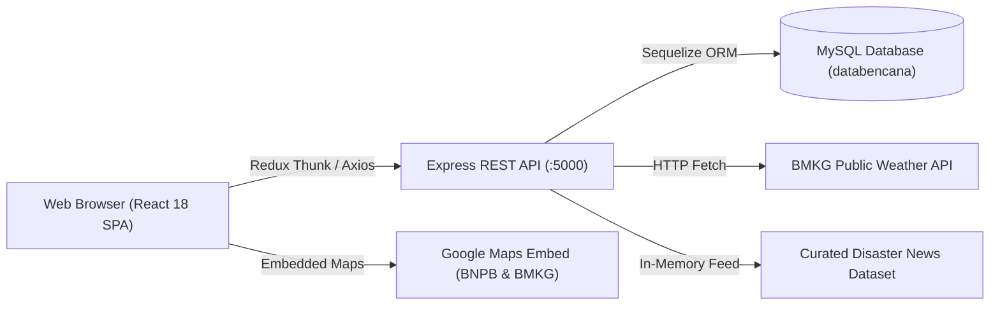
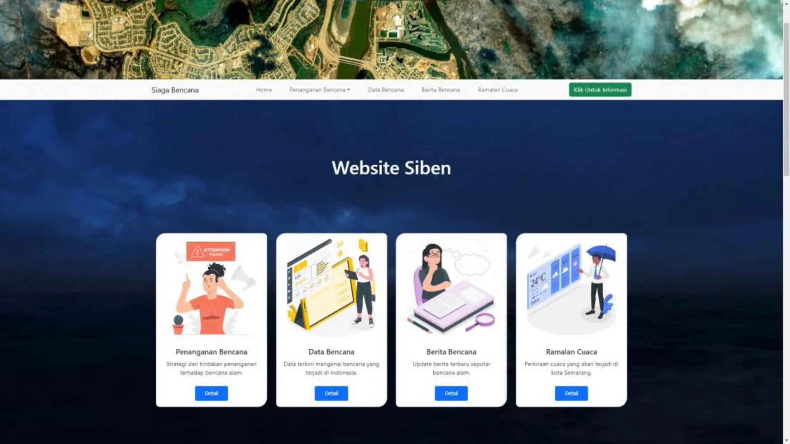
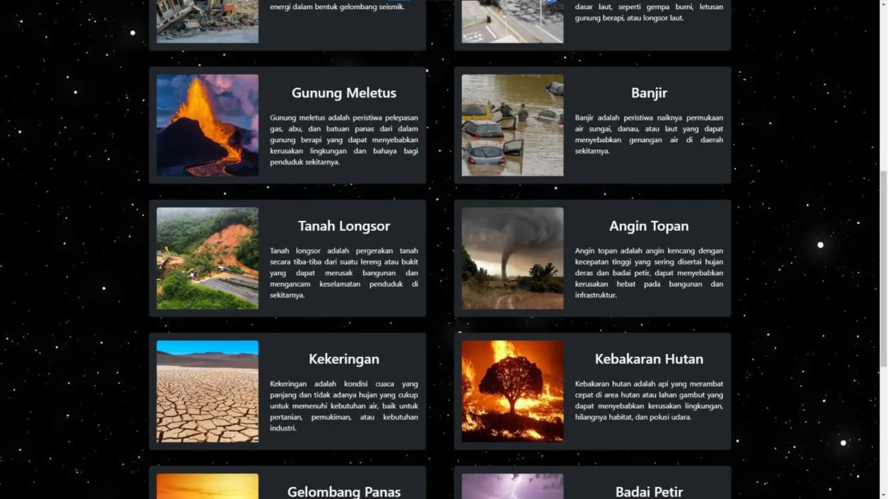
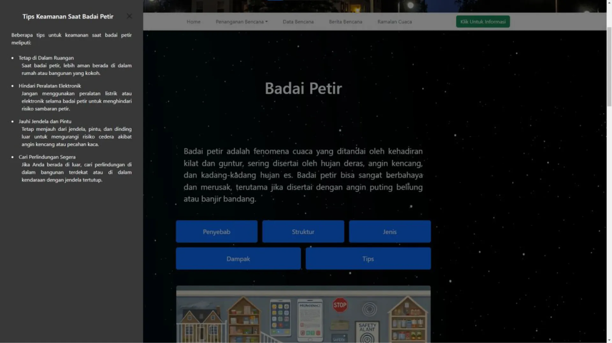
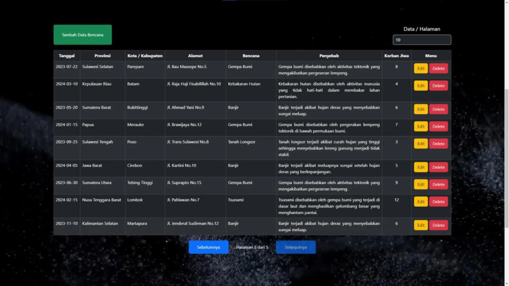
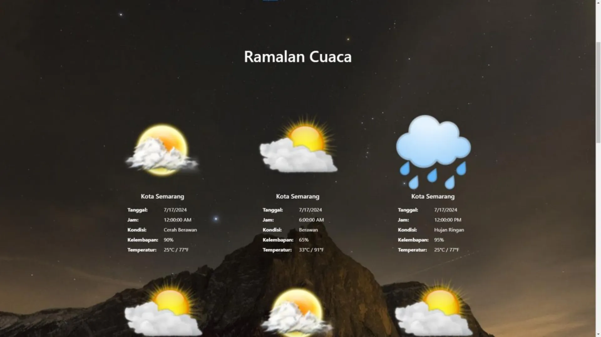

# Siben - Disaster Preparedness


## Project Overview

Siben (Siaga Bencana) is a full-stack disaster preparedness and incident information web platform built with React, Redux, Express, Sequelize, and MySQL. It centralizes public disaster education, structured incident record management, national disaster news updates, and regional meteorological forecasts for Semarang City. By unifying step-by-step hazard mitigation guides with live BMKG weather proxying and persistent incident records, the platform supports accessible community readiness and situational awareness.

## Key Features

- **Interactive Landing Hub & Disaster Lifecycle Carousel**: Provides direct navigation to all four application modules, an informational modal, a three-stage disaster management carousel (Mitigation, Emergency Response, Recovery), and an embedded BNPB headquarters map.
- **Ten Hazard-Specific Preparedness Guides**: Dedicated routes and interactive views for Earthquake, Tsunami, Volcanic Eruption, Flood, Landslide, Cyclone, Drought, Wildfires, Heatwave, and Thunderstorm hazards, complete with offcanvas detail panels (causes, structure, types, impacts, safety tips) and three-phase accordion checklists.
- **Disaster Incident CRUD & Pagination**: Full create, read, update, and delete workflows backed by MySQL and Sequelize, featuring client-side pagination with configurable page sizes (`5`, `10`, `20`, `50` records per page) and modal forms covering all Indonesian provinces and hazard types.
- **Disaster News Feed**: Asynchronous news aggregation endpoint (`/news` and `/news/:id`) rendering dated incident reports with cover imagery, author attribution, and external source links.
- **Live BMKG Semarang Weather Forecast**: Express backend proxy (`GET /weather`) consuming the official BMKG public weather forecast API for Semarang Tengah (`adm4=33.74.01.1001`), transforming temperature into Celsius and Fahrenheit alongside humidity, weather icons, and an embedded BMKG Semarang office map.

## Tech Stack

| Category | Technology | Purpose |
| --- | --- | --- |
| Frontend Library | React (`18.3.1`) | Component-based single-page user interface and view rendering |
| State Management | Redux & Redux Thunk (`5.0.1`) | Centralized state store and asynchronous API data fetching for disasters and weather |
| Routing | React Router DOM (`6.24.1`) | Client-side navigation across main modules and ten hazard subpages |
| UI Framework | React Bootstrap & Bootstrap (`5.3.3`) | Responsive grid layout, tables, modals, offcanvas drawers, carousels, and accordions |
| HTTP Client | Axios (`1.7.2`) | Frontend API requests to the Express backend for CRUD, news, and weather endpoints |
| Backend Framework | Express (`4.19.2`) | RESTful API server handling disaster CRUD routes, news feeds, and BMKG weather proxying |
| ORM & Migrations | Sequelize & Sequelize CLI (`6.37.3`) | Relational model mapping, schema migrations, and database seeding |
| Database | MySQL (`mysql2` `3.10.2`) | Persistent storage for structured disaster incident records (`databencana`) |
| Process Runner | Concurrently (`8.2.2`) | Unified root script execution for running frontend and backend servers simultaneously |

## Application Architecture

The application uses a decoupled full-stack architecture consisting of a React single-page frontend and an Express REST API backend. Client views dispatch Redux Thunk actions and Axios requests to the Express server configured via `REACT_APP_API_URL`, which in turn coordinates MySQL persistence through Sequelize ORM for disaster records, serves curated news article payloads, and proxies live meteorological forecasts from the external BMKG public API.



## Screenshots / Preview

### 1. Landing Page & Module Hub

The main landing page presents the navigation bar, information modal trigger, ambient video backdrop, and four interactive module cards linking directly to disaster handling guides, incident data records, disaster news, and weather forecasts.

### 2. Disaster Handling Catalog

The disaster handling index organizes ten natural hazard categories—including Earthquake, Tsunami, Volcanic Eruption, Flood, Landslide, Cyclone, Drought, Wildfire, Heatwave, and Thunderstorm—into illustrated cards that route to dedicated mitigation subpages.

### 3. Hazard Detail & Safety Tips Offcanvas

Each hazard subpage (shown for Thunderstorm) provides categorized interactive buttons (`Penyebab`, `Struktur`, `Jenis`, `Dampak`, `Tips`) that open an offcanvas reference drawer alongside three-phase preparedness, response, and recovery accordions.

### 4. Disaster Data CRUD & Paginated Table

The disaster data management view renders MySQL-backed incident records in a paginated dark table with configurable rows per page (`5`–`50`), modal-driven record creation and editing, and one-click deletion.

### 5. Semarang Weather Forecast Dashboard

The weather forecast module displays live BMKG meteorological data for Semarang City across translucent cards containing weather icons, timestamps, conditions, humidity percentages, and dual Celsius/Fahrenheit temperatures.

## Prerequisites

- **Node.js** (v18 or higher recommended; required for native `fetch` support in `backend/server.js`)
- **npm** (bundled with Node.js)
- **MySQL Server** (local or accessible instance configured for the `databencana` database)

## Installation & Setup

1. Clone the repository and enter the project directory:
```bash
git clone https://github.com/weztcy/Siben-Disaster-Preparedness.git
cd "Siben - Disaster Preparedness"
```

2. Install root, backend, and frontend dependencies:
```bash
npm install
npm run install:all
```

3. Ensure MySQL is running and create the development database configured in `backend/config/config.json` (`databencana`), then run the Sequelize migration and optional seed script:
```bash
cd backend
npx sequelize-cli db:migrate
node seed_disasters.js
```

4. Verify the frontend environment file `frontend/.env` points to your backend URL (defaults to `http://localhost:5000`).

## Usage

You can start both the Express backend server and the React development server together from the repository root using `concurrently`, or run each workspace independently.

1. Start both the backend (`:5000`) and frontend (`:3000`) concurrently from the root directory:
```bash
npm start
```

2. Or start the backend and frontend in separate terminals:
```bash
npm run server
npm run client
```

3. Open `http://localhost:3000` in your browser to browse hazard guides, manage disaster records, read disaster news, and inspect Semarang weather forecasts.

## Environment Variables

The frontend reads its backend API base URL from `frontend/.env` via React Scripts environment injection, falling back to `http://localhost:5000` in `frontend/src/config.js`.

| Variable | Description | Example |
| --- | --- | --- |
| `REACT_APP_API_URL` | Base URL for Express REST API requests from the React client | `http://localhost:5000` |

```env
REACT_APP_API_URL=http://localhost:5000
```

## API Documentation

The Express server (`backend/server.js`) exposes RESTful JSON endpoints on port `5000` with CORS enabled for disaster record management, curated news retrieval, and BMKG weather forecasting.

| Method | Endpoint | Description | Authentication |
| --- | --- | --- | --- |
| `GET` | `/disasters` | Retrieve all disaster records ordered by `tanggal_bencana` descending | None |
| `GET` | `/disasters/:id` | Retrieve a single disaster record by primary key ID | None |
| `POST` | `/disasters` | Create a new disaster incident record | None |
| `PUT` | `/disasters/:id` | Update an existing disaster incident record by ID | None |
| `DELETE` | `/disasters/:id` | Delete a disaster incident record by ID | None |
| `GET` | `/news` | Retrieve the list of curated disaster news articles | None |
| `GET` | `/news/:id` | Retrieve a single disaster news article by ID | None |
| `GET` | `/weather` | Fetch and normalize Semarang Tengah weather forecasts from BMKG | None |

Example `POST /disasters` request payload:
```json
{
  "tanggal_bencana": "2023-07-22",
  "provinsi": "Sulawesi Selatan",
  "kota_kabupaten": "Parepare",
  "alamat_lokasi": "Jl. Bau Massepe No.5",
  "bencana_alam": "Gempa Bumi",
  "penjelasan_penyebab": "Gempa bumi disebabkan oleh aktivitas tektonik yang mengakibatkan pergeseran lempeng.",
  "korban_jiwa": 8
}
```

## API Integration

The platform integrates external meteorological and mapping services alongside internal REST consumption.

| API / Service | Purpose | Usage |
| --- | --- | --- |
| BMKG Public Weather API (`api.bmkg.go.id`) | Real-time regional weather forecast data for Semarang Tengah (`adm4=33.74.01.1001`) | Queried by `GET /weather` in `backend/server.js`, flattened, and normalized with Celsius/Fahrenheit conversion |
| Google Maps Embed | Geographic location visualization for disaster agencies | Embedded via `<iframe>` on the Home page (BNPB Pusat) and Weather page (BMKG Maritime Meteorology Station Class II Semarang) |

## Database Configuration

MySQL persistence is managed with Sequelize (`backend/models/index.js`, `backend/models/disaster.js`, and `backend/config/config.json`) using the `Disasters` table inside the `databencana` database.

1. Configure your MySQL host, username, password, and database name (`databencana`) in `backend/config/config.json`.
2. Execute the table migration to create the `Disasters` schema (`tanggal_bencana`, `provinsi`, `kota_kabupaten`, `alamat_lokasi`, `bencana_alam`, `penjelasan_penyebab`, `korban_jiwa`):
```bash
cd backend
npx sequelize-cli db:migrate
```
3. Populate sample Indonesian historical disaster records using the included seed script:
```bash
node seed_disasters.js
```

## Build & Deployment

To prepare the frontend for production hosting alongside the Express API server, generate a static production bundle with React Scripts.

1. Build the optimized React static assets in `frontend/build/`:
```bash
npm run build --prefix frontend
```

2. Run the Express backend API server:
```bash
npm run server
```

## Contributing

Contributions to improve documentation, data accuracy, or hazard mitigation content are welcome.

1. Fork the repository.
2. Create a branch for the change (`git checkout -b feature/your-feature`).
3. Make and test the changes locally.
4. Commit and push the branch to your fork.
5. Open a pull request with a clear explanation of your changes.

## License

This project is licensed under the MIT License.
See the [LICENSE](LICENSE) file for details.

## Author & Contact

**Yohanes Dimas Pratama**

- GitHub: [github.com/weztcy](https://github.com/weztcy)
- Portfolio: [yohanesdimas.com](https://yohanesdimas.com)
- LinkedIn: [linkedin.com/in/yohanes-dimas](https://www.linkedin.com/in/yohanes-dimas)
